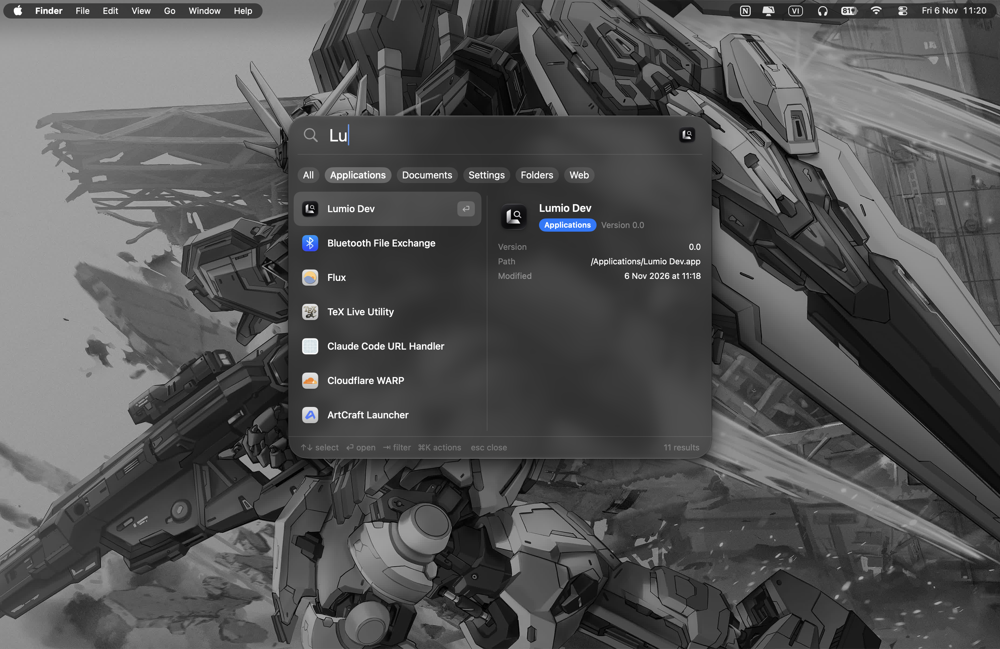
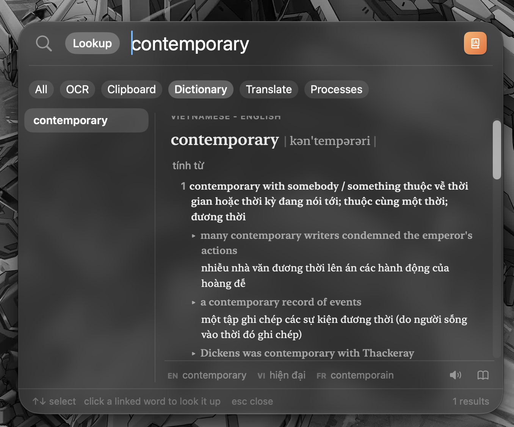
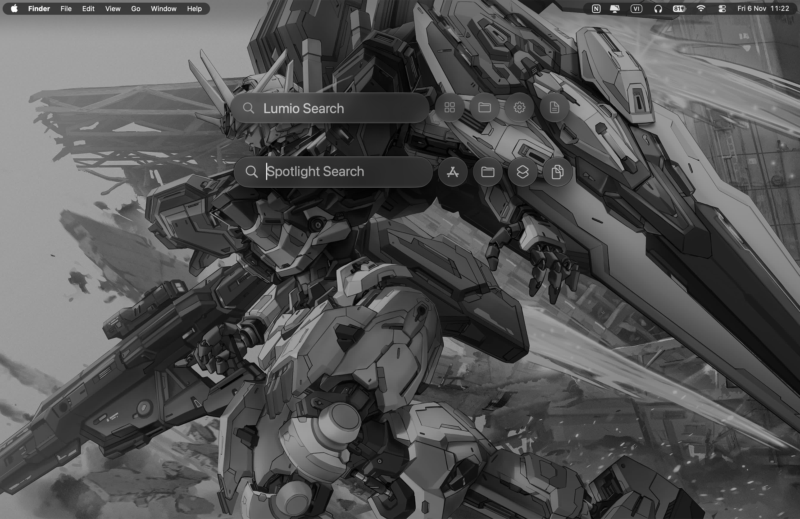
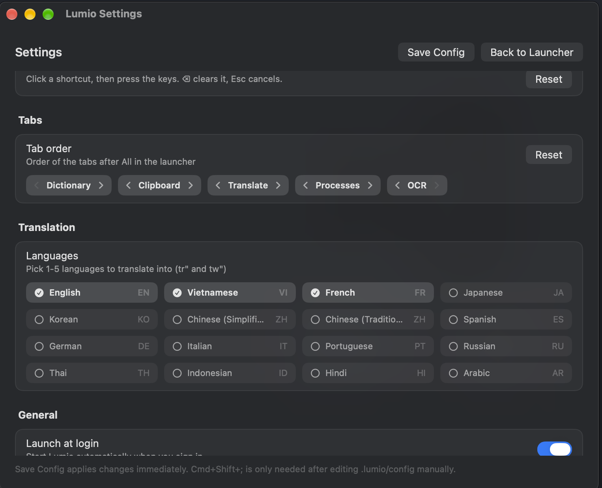

<div align="center">
    
    <h1>Lumio</h1>
    <p><strong>A fast, free and open-source keyboard launcher for macOS.</strong></p>
    <p>Press <code>Option+Space</code> to find apps, files, browser tabs and more. Lumio combines a Rust search index, macOS Spotlight and on-device OCR in a native SwiftUI launcher, with Fluent Search–inspired tags and actions.</p>
    <p>A fork of <a href="https://github.com/kunkka19xx/look"><strong>kunkka19xx/look</strong></a>. Huge thanks to <a href="https://github.com/kunkka19xx">kunkka19xx</a> for the original work this project builds on.</p>
</div>

<div align="center">

[](https://github.com/cavaldos/Lumio/releases/latest)
[](https://github.com/cavaldos/Lumio/releases)


[](https://github.com/cavaldos/Lumio/stargazers)
[](https://github.com/cavaldos/Lumio/network/members)
[](LICENSE)
[](https://ko-fi.com/calvados)

</div>

## Demo

<p align="center">
  <a href="https://github.com/cavaldos/Lumio/raw/main/assets/lumio-ui/video-demo.mp4">
    
  </a>
</p>

## Screenshots

<p align="center">
  
</p>
<p align="center">
  
  
  
</p>

## How Lumio compares

Lumio is in the same family as Spotlight, Alfred and Raycast: a keyboard launcher for apps, files and quick tools. The difference is that Lumio is free and open source, and it adds OCR search inside images and PDFs and a dictionary lookup on any selected word.

| | Lumio | Spotlight | [Alfred](https://www.alfredapp.com) | [Raycast](https://www.raycast.com) |
| --- | --- | --- | --- | --- |
| Price | Free | Free, built into macOS | Free core; paid Powerpack license for workflows, clipboard and snippets | Free core; paid Pro plan for cloud sync and AI |
| Open source | Yes (GPL-3.0) | No | No | No |
| Platform | macOS 15+, Apple Silicon | macOS | macOS | macOS |
| App and file search | Yes | Yes | Yes | Yes |
| Calculator | Yes (`+ - * / % ^ ()`) | Yes | Yes | Yes |
| Clipboard history | Yes | — | Yes (Powerpack) | Yes |
| OCR search in images and PDFs | Yes, dedicated tab | PDF text | Via workflows | Via extensions |
| Dictionary lookup on selected text | Yes, `Option+Space` | Yes (Look Up) | Via workflows | Via extensions |
| Translation | Yes, on-device with Apple's Translation framework, no API key | — | Via workflows | Via extensions |
| Extensions and workflows | No, built-in modes only | Limited (Shortcuts) | Yes, large workflow community | Yes, extension store (TypeScript) |
| Window management | No | No | Via workflows | Yes, built in |
| AI chat | No | — | Via workflows | Yes (Pro) |

**Choose Lumio if** you want a free, open-source launcher that keeps your files and clipboard on your Mac, finds text inside screenshots and scanned PDFs, and does not need an account or a subscription.

**Choose Raycast or Alfred if** you need an extension ecosystem, window management, AI chat or a large library of ready-made workflows. Both are more mature and more extensible than Lumio.

**Choose Spotlight if** you want zero setup and only need basic app, file and web search. It is already on your Mac.

**Lumio's limits.** No plugin or workflow system, no window management, no AI features, no cloud sync, and it runs only on Apple Silicon Macs with macOS 15 or later.

_Competitor features and pricing change often. Check their websites for the latest details._

## Install

Requires macOS 15 or later on Apple Silicon.

**Homebrew** (recommended, updates with `brew upgrade`):

```bash
brew tap cavaldos/tap
brew install --cask cavaldos/tap/lumio
```

This also adds a `lumio` command to your shell.

**Manual:**

1. Download [`Lumio.dmg`](https://github.com/cavaldos/Lumio/releases/latest/download/Lumio.dmg) from the [latest release](https://github.com/cavaldos/Lumio/releases/latest).
2. Open it and drag `Lumio.app` into `Applications`.
3. Clear the quarantine flag. Releases are ad-hoc signed and not notarized, so Gatekeeper would otherwise block the first launch:

```bash
xattr -dr com.apple.quarantine /Applications/Lumio.app
```

Then open Lumio and press **`Option+Space`**. Optionally add the `lumio` command: `ln -sf /Applications/Lumio.app/Contents/MacOS/Lumio /opt/homebrew/bin/lumio`.

**Updates.** Lumio updates itself: it checks once a day and asks before installing a new version. Check right away from Settings → About → **Check for Updates**, where you can also turn the daily check off. Homebrew installs can also update with `brew upgrade --cask lumio`.

For local development, see [CONTRIBUTING.md](CONTRIBUTING.md#development-setup).

## Uninstall

**Homebrew:**

```bash
brew uninstall --cask lumio
```

Add `--zap` to also remove the settings and data.

**Manual:** quit Lumio, then remove the app, its command and its data:

```bash
rm -rf /Applications/Lumio.app /opt/homebrew/bin/lumio
rm -rf ~/.lumio "$HOME/Library/Application Support/lumio"
```

## Usage

| Action | Shortcut |
| --- | --- |
| Show / hide Lumio | `Option+Space` |
| Settings | `Cmd+Shift+Space` |
| Open / run | `Enter` |
| Search the web | `Cmd+Enter` |
| Show in Finder | `Cmd+F` |
| Open in your editor / terminal | `Cmd+E` / `Cmd+T` |
| Actions for the selected item | `Cmd+K` |
| Move to Trash (delete a clip in clipboard mode) | `Cmd+D` |
| Hide the selected app from results | `Cmd+Shift+H` |
| Browse launcher tabs | `Cmd+1` … `Cmd+4` (depends on tab order) |
| Search tag (`yt`, `g`, `drive`, `gh`…) | type keyword, then `Tab` |
| Browse search tags | `Option+T` |
| Cycle result filters | `Tab` / `Shift+Tab` |
| Pin / unpin a result | `Cmd+Shift+P` |
| Quick Look preview | `Shift+Enter` / `Cmd+Y` |
| Cycle sort order | `Option+S` |
| Command mode | `Cmd+/` |
| Help | `Cmd+H` |
| Close | `Esc` |

Select a word in any app before pressing `Option+Space` and Lumio opens straight on its dictionary entry (needs Accessibility, asked once).

**OCR tab.** Find images and PDFs by the text *inside* them, not just their name. It is the last tab; reading the files runs in a separate process that starts only when you open it, so Lumio itself stays light. See [OCR search](assets/docs/ocr-search.md).

### Fluent Search–inspired search

Lumio combines its own fuzzy index with macOS Spotlight: the latter adds matches from your home folder, iCloud Drive and indexed external drives. Search results can include browser bookmarks, history, open tabs and windows. Results learn from what you open; the detail pane offers previews, file actions and clickable tags. Drag files or links out to other apps.

Type a tag and press `Tab` to narrow a search. Tags can be stacked, and `Option+T` opens the tag browser:

```text
yt Tab lofi beats          Search YouTube
pdf Tab contract           Find PDFs by name
downloads Tab pdf Tab      Find PDFs in Downloads
~/Projects Tab             Search a specific folder
content Tab invoice        Search document text via Spotlight
windows Tab                List open windows
```

`content` searches Spotlight's text index; the **OCR** tab separately finds text in images and scanned PDFs. Open browser tabs switch to the existing tab with `Enter`. You can pin results to Home with `Cmd+Shift+P` and optionally enable recent apps and files in Settings → General → **Suggestions when empty**. Choose Finder or another file manager in Settings → General.

See [Search tags, browser tabs and suggestions](assets/docs/search-tags.md) for supported browsers, custom tags, shortcuts and configuration.

**Commands and conversions.** Type `:` or press `Cmd+/` for `:kill <name, PID or port>`, `:emptytrash` and `:help`. Type `> npm run dev` to run a terminal command, or enter conversions such as `5 km to miles` and `100 usd to gbp`.

## Configuration

Settings live in `~/.lumio/config`, created on first launch. Use Settings (`Cmd+Shift+Space`) to configure indexing, skipped folders, search, shortcuts and your file manager. After choosing a skipped folder, click **Save Config**; it and its contents are excluded from Lumio file search. You can also edit the config file and press `Cmd+Shift+;` to reload.

Other options include scan depth and limits, ignore patterns, search aliases, OCR, tab order, clipboard history, custom search tags, web suggestions and the editor and terminal used by `Cmd+E` / `Cmd+T`.

## Permissions

Most features work without special permissions. macOS may request access when you use these features:

- **Accessibility**: read selected text and list or switch to open windows.
- **Automation**: access open tabs in each supported browser, or empty the Trash via Finder.
- **Full Disk Access**: read Safari bookmarks and history. Other features continue to work without it.

## Privacy and network access

File indexing, OCR and clipboard history run locally. Browser bookmarks and history are read from local browser data. Web suggestions are enabled by default and send the typed query to Google's suggestion service; set `web_suggestions=tags` to limit them to web tags, or `web_suggestions=off` to disable them. Currency conversion downloads public exchange rates, and search-tag icons may be fetched from Google's icon service. Updates and web searches also use the network.

## Documentation

- [Architecture](assets/docs/architecture.md)
- [Rust core](assets/docs/core.md)
- [FFI bridge](assets/docs/ffi-bridge.md)
- [macOS app](assets/docs/macos-app.md)
- [OCR search](assets/docs/ocr-search.md)
- [Search tags, browser tabs and suggestions](assets/docs/search-tags.md)
- [Build and release](assets/docs/build-and-release.md)

## Contributing

See [CONTRIBUTING.md](CONTRIBUTING.md).

## Acknowledgments

A fork of [look](https://github.com/kunkka19xx/look) by [kunkka19xx](https://github.com/kunkka19xx). Huge thanks for the original work this project builds on.

## License

[GPL-3.0](LICENSE). Lumio is and will always remain open-source and free.

## Star History

<a href="https://star-history.com/#cavaldos/Lumio&Date">
    
</a>
