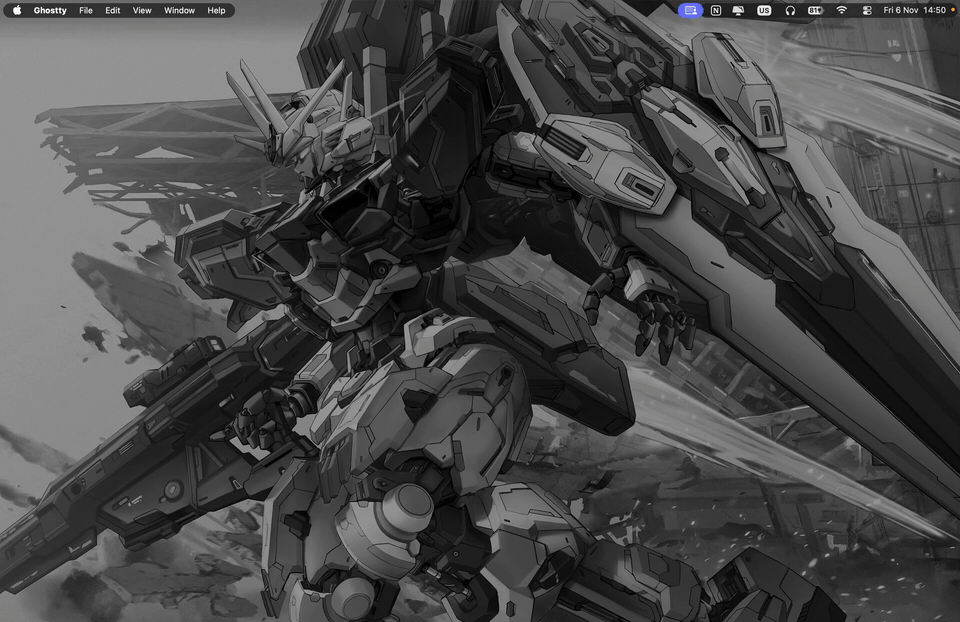
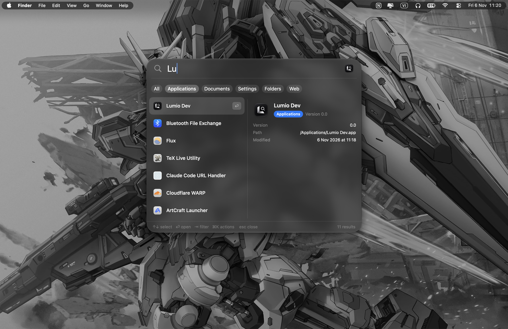
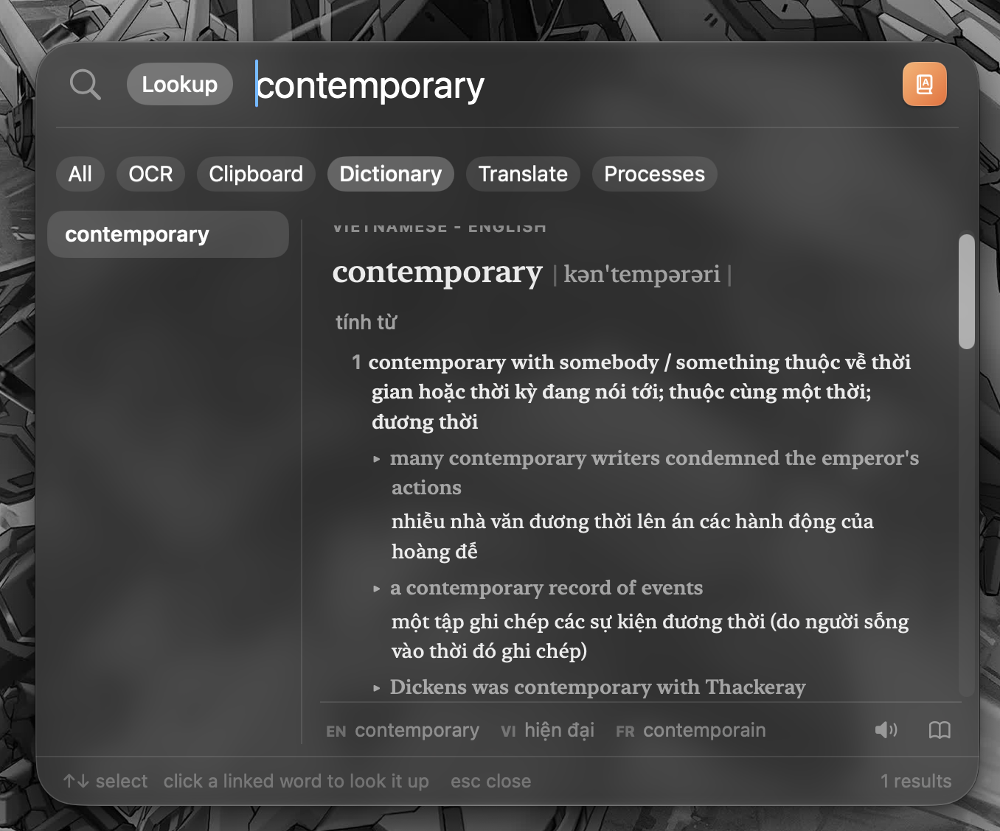
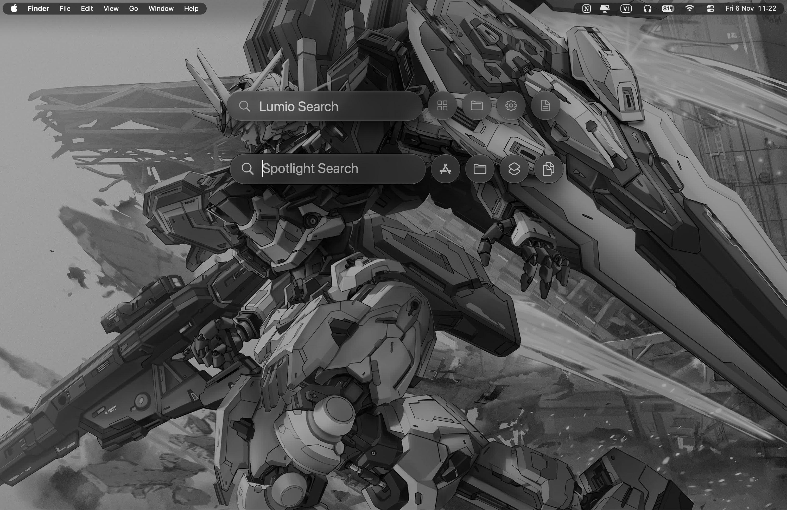
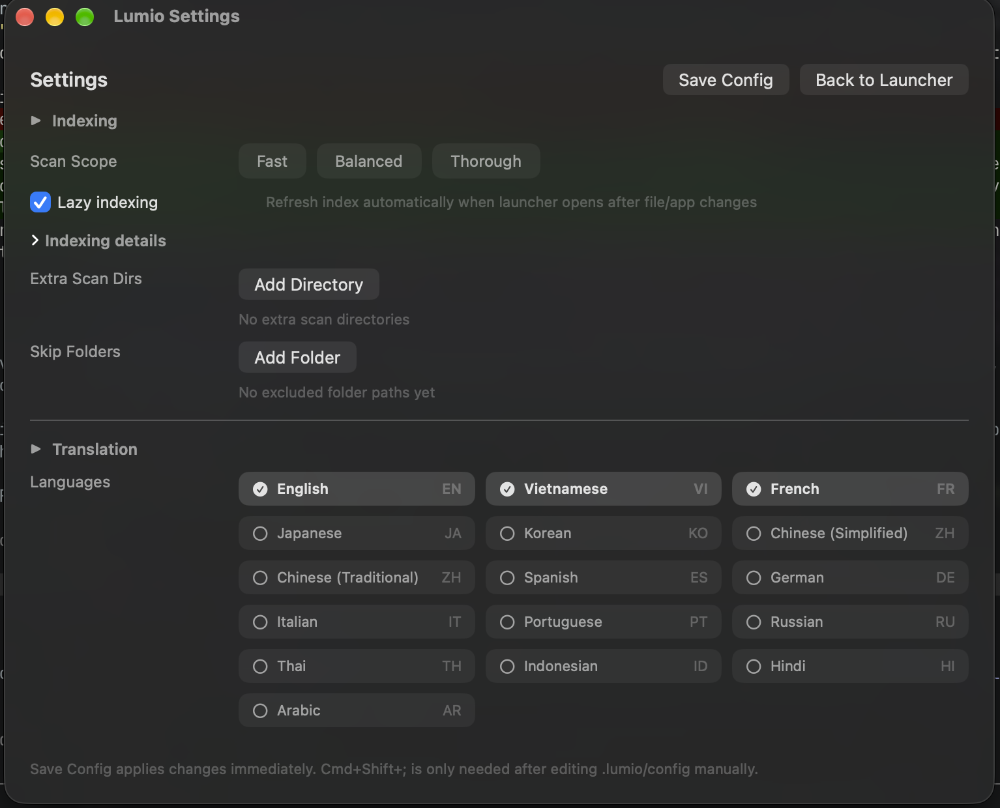

<div align="center">
    
    <h1>Lumio</h1>
    <p><strong>A fast, free and open-source keyboard launcher for macOS.</strong></p>
    <p>Press <code>Option+Space</code> and get results as you type. A Rust core searches apps, files, folders, clipboard history and text inside images and PDFs (OCR) in milliseconds, behind a native SwiftUI interface. Everything runs locally on your Mac.</p>
    <p>A fork of <a href="https://github.com/kunkka19xx/look"><strong>kunkka19xx/look</strong></a>. Huge thanks to <a href="https://github.com/kunkka19xx">kunkka19xx</a> for the original work this project builds on.</p>
</div>

<div align="center">

[](https://github.com/cavaldos/Lumio/releases/latest)
[](https://github.com/cavaldos/Lumio/releases)


[](https://github.com/cavaldos/Lumio/stargazers)
[](https://github.com/cavaldos/Lumio/network/members)
[](LICENSE)
[](https://ko-fi.com/calvados)

</div>

## Demo

<p align="center">
  <a href="https://github.com/cavaldos/Lumio/raw/main/assets/lumio-ui/video-demo.mp4">
    
  </a>
</p>

## Screenshots

<p align="center">
  
</p>
<p align="center">
  
  
  
</p>

## Install

Requires macOS 15 or later on Apple Silicon.

**Homebrew** (recommended, updates with `brew upgrade`):

```bash
brew tap cavaldos/tap
brew install --cask cavaldos/tap/lumio
```

This also adds a `lumio` command to your shell.

**Manual:**

1. Download [`Lumio.dmg`](https://github.com/cavaldos/Lumio/releases/latest/download/Lumio.dmg) from the [latest release](https://github.com/cavaldos/Lumio/releases/latest).
2. Open it and drag `Lumio.app` into `Applications`.
3. Clear the quarantine flag. Releases are ad-hoc signed and not notarized, so Gatekeeper would otherwise block the first launch:

```bash
xattr -dr com.apple.quarantine /Applications/Lumio.app
```

Then open Lumio and press **`Option+Space`**. Optionally add the `lumio` command: `ln -sf /Applications/Lumio.app/Contents/MacOS/Lumio /opt/homebrew/bin/lumio`.

**Updates.** Lumio updates itself: it checks once a day and asks before installing a new version. Check right away from Settings → About → **Check for Updates**, where you can also turn the daily check off. Homebrew installs can also update with `brew upgrade --cask lumio`.

For local development, see [CONTRIBUTING.md](CONTRIBUTING.md#development-setup).

## Uninstall

**Homebrew:**

```bash
brew uninstall --cask lumio
```

Add `--zap` to also remove the settings and data.

**Manual:** quit Lumio, then remove the app, its command and its data:

```bash
rm -rf /Applications/Lumio.app /opt/homebrew/bin/lumio
rm -rf ~/.lumio "$HOME/Library/Application Support/lumio"
```

## Usage

| Action | Shortcut |
| --- | --- |
| Show / hide Lumio | `Option+Space` |
| Settings | `Cmd+Shift+Space` |
| Open / run | `Enter` |
| Search the web | `Cmd+Enter` |
| Show in Finder | `Cmd+F` |
| Open in your editor / terminal | `Cmd+E` / `Cmd+T` |
| Actions for the selected item | `Cmd+K` |
| Move to Trash (delete a clip in clipboard mode) | `Cmd+D` |
| Hide the selected app from results | `Cmd+Shift+H` |
| Browse Applications / Folders / Documents / OCR | `Cmd+1` … `Cmd+4` |
| Cycle result filters | `Tab` / `Shift+Tab` |
| Command mode | `Cmd+/` |
| Help | `Cmd+H` |
| Close | `Esc` |

Select a word in any app before pressing `Option+Space` and Lumio opens straight on its dictionary entry (needs Accessibility, asked once).

**OCR tab.** Find images and PDFs by the text *inside* them, not just their name. It is the last tab; reading the files runs in a separate process that starts only when you open it, so Lumio itself stays light. See [OCR search](assets/docs/ocr-search.md).

**Commands.** Type `:` or press `Cmd+/`: `:kill <name, PID or port>`, `:emptytrash`, `:help`.

## Configuration

Settings live in `~/.lumio/config`, created on first launch: which folders to index, scan depth and limits, ignore patterns, search aliases (`alias_code=Visual Studio Code|Cursor|Zed`), OCR search, the order of the launcher tabs (`tab_order`), clipboard history size, and the editor and terminal behind `Cmd+E` / `Cmd+T`. Change them from Settings (`Cmd+Shift+Space`), or edit the file and press `Cmd+Shift+;` to reload.

## Permissions

Lumio works without any special permission. Two are asked for only when you use the feature:

- **Accessibility**: to read the selected word for a dictionary lookup.
- **Automation (Finder)**: to empty the Trash, which macOS protects.

## Documentation

- [Architecture](assets/docs/architecture.md)
- [Rust core](assets/docs/core.md)
- [FFI bridge](assets/docs/ffi-bridge.md)
- [macOS app](assets/docs/macos-app.md)
- [OCR search](assets/docs/ocr-search.md)
- [Build and release](assets/docs/build-and-release.md)

## Contributing

See [CONTRIBUTING.md](CONTRIBUTING.md).

## Acknowledgments

A fork of [look](https://github.com/kunkka19xx/look) by [kunkka19xx](https://github.com/kunkka19xx). Huge thanks for the original work this project builds on.

## License

[GPL-3.0](LICENSE). Lumio is and will always remain open-source and free.

## Star History

<a href="https://star-history.com/#cavaldos/Lumio&Date">
    
</a>
